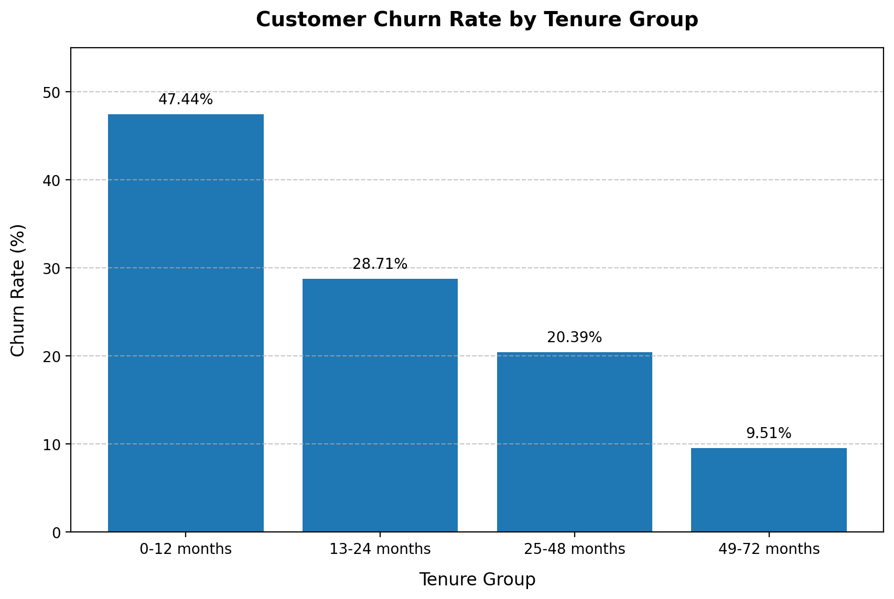
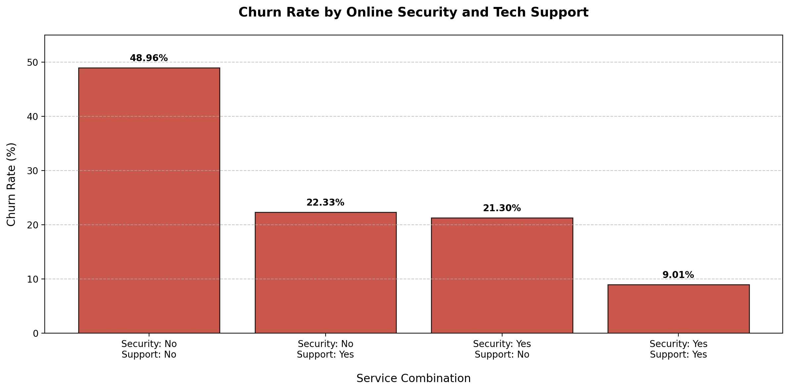
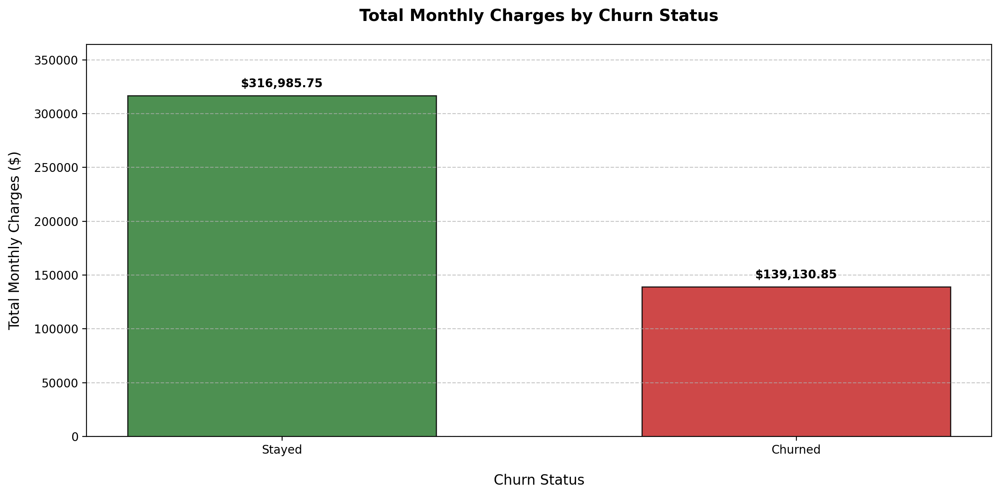
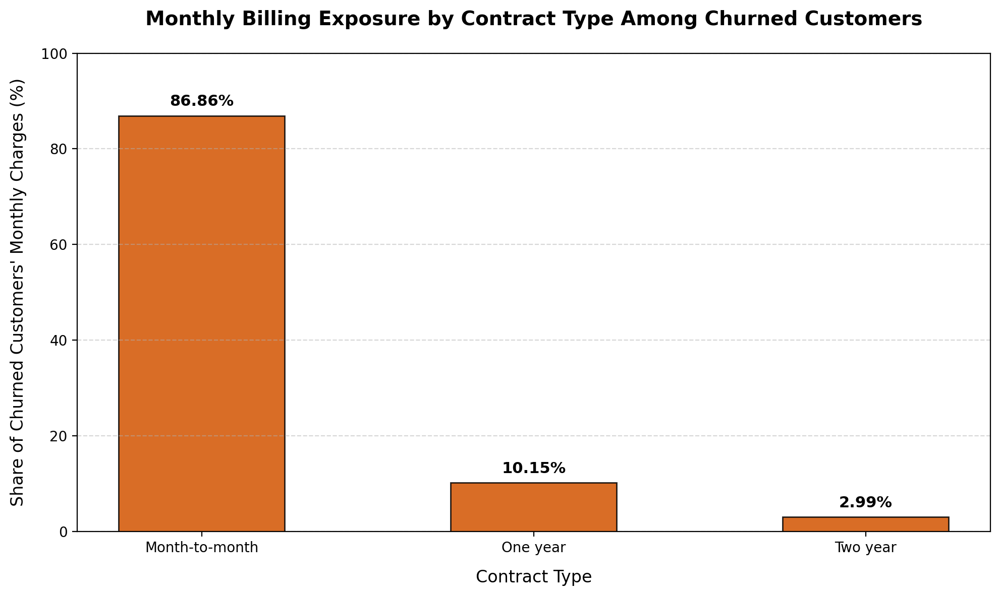
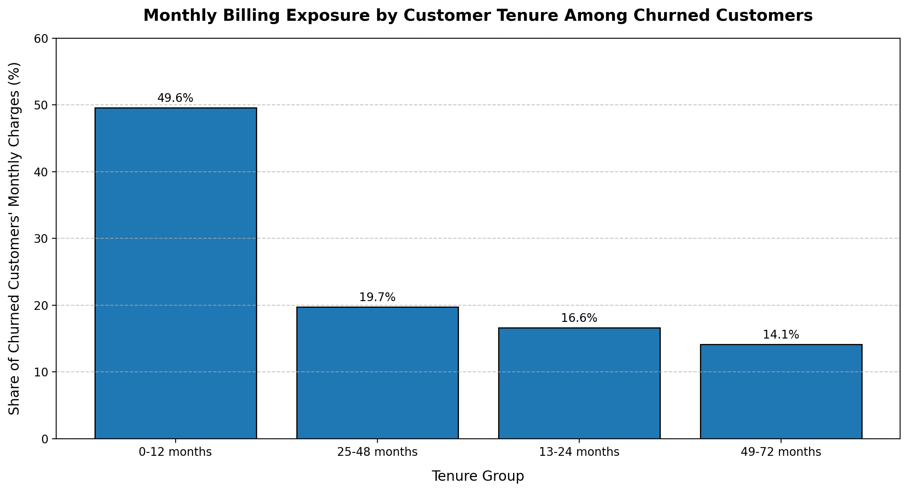

# Customer Churn & Retention Analysis

## Project Overview

Customer retention is an important driver of sustainable business growth. This project analyses customer churn patterns for a telecommunications company to identify customer segments associated with higher churn and understand the financial exposure associated with customer attrition.

Using Python, Pandas, Matplotlib and MySQL, the project explores customer demographics, service subscriptions, contract types, tenure and monthly charges.

The objective is to translate customer data into actionable business insights that can support customer retention strategies.

## Business Objectives

- Measure the overall customer churn rate.
- Identify customer segments with higher churn rates.
- Analyse the relationship between contract type, tenure and churn.
- Investigate whether monthly charges are associated with customer churn.
- Evaluate churn patterns across internet services and service combinations.
- Assess monthly billing exposure associated with churned customers.
- Develop data-driven customer retention recommendations.

## Tools & Technologies

| Tool | Application |
|---|---|
| Python | Data cleaning and analysis |
| Pandas | Data manipulation and aggregation |
| Matplotlib | Data visualisation |
| MySQL | SQL-based business analysis |
| Jupyter Notebook | Analysis and documentation |
| Git & GitHub | Version control and project hosting |

## Dataset

The project uses the IBM Telco Customer Churn dataset, containing 7,043 customer records and 21 original columns.

The dataset includes:

- Customer demographics
- Customer tenure
- Contract information
- Internet and additional services
- Monthly and accumulated charges
- Customer churn status

**Dataset source:** [IBM Telco Customer Churn Dataset](https://github.com/IBM/telco-customer-churn-on-icp4d)

The raw and processed CSV files are excluded from this repository.

To reproduce the analysis, download the CSV from the source repository and place it at:

`data/raw/Telco-Customer-Churn.csv`

The Python notebook cleans the dataset and exports a processed version to `data/processed/` for SQL analysis.

## Project Structure

```text
customer-churn-retention-analysis/
├── data/
│   ├── raw/                 # Original dataset (not tracked)
│   └── processed/           # Cleaned dataset (not tracked)
│
├── notebooks/
│   └── 01_customer_churn_analysis.ipynb
│
├── sql/
│   ├── 01_overall_churn_analysis.sql
│   ├── 02_contract_churn_analysis.sql
│   ├── 03_tenure_churn_analysis.sql
│   ├── 04_internet_service_churn_analysis.sql
│   ├── 05_monthly_charges_churn_analysis.sql
│   ├── 06_contract_monthly_charges_churn_analysis.sql
│   ├── 07_service_combination_churn_analysis.sql
│   └── 08_contract_tenure_churn_analysis.sql
│
├── reports/
│   └── figures/
│       ├── 01_churn_by_tenure.png
│       ├── 02_churn_by_service_combination.png
│       ├── 03_monthly_charges_by_churn.png
│       ├── 04_monthly_billing_exposure_by_contract.png
│       └── 05_monthly_billing_exposure_by_tenure.png
│
├── .gitignore
└── README.md
```

## Data Cleaning & Preparation

The dataset was inspected and cleaned using Python and Pandas.

Key steps included:

- Examining dataset dimensions, column names and data types.
- Checking for missing values and duplicate records.
- Identifying 11 blank entries in `TotalCharges`.
- Replacing blank `TotalCharges` values with zero for customers with zero tenure.
- Converting `TotalCharges` into numeric format.
- Creating customer tenure groups.
- Exporting the cleaned dataset for MySQL analysis.

## Python Analysis

The following areas were investigated:

1. Overall customer churn distribution.
2. Contract-wise customer churn.
3. Customer tenure and churn patterns.
4. Internet service churn.
5. Monthly charges and customer churn.
6. Online Security and Tech Support service combinations.
7. Revenue contribution by contract type.
8. Revenue contribution by customer tenure.
9. Contract type and customer tenure segmentation.

## SQL Analysis

Eight SQL scripts were developed in MySQL to reproduce and extend selected findings from the Python analysis.

SQL concepts used:

- SELECT and WHERE
- CASE WHEN
- GROUP BY
- COUNT and SUM
- Conditional aggregation
- ROUND
- ORDER BY
- Aggregate functions
- Multi-dimensional grouping

Python and SQL results were cross-checked to ensure consistency.


## Visualisations

The following charts illustrate key patterns identified during the customer churn analysis.

### 1. Customer Churn Rate by Tenure



### 2. Churn by Online Security and Tech Support



### 3. Monthly Charges by Churn Status



### 4. Monthly Billing Exposure by Contract Type



### 5. Monthly Billing Exposure by Customer Tenure



## Key Business Findings

### 1. Overall Customer Churn

The overall customer churn rate is **26.54%**, representing 1,869 customers out of 7,043.

### 2. Contract Type

Month-to-month contracts have the highest churn rate at **42.71%**, compared with 11.27% for one-year contracts and 2.83% for two-year contracts.

### 3. Customer Tenure

Customers with 0–12 months of tenure have the highest churn rate at **47.44%**. Churn generally declines across longer tenure groups.

### 4. Internet Service

Fiber optic customers have a churn rate of **41.89%**, compared with 18.96% for DSL customers.

### 5. Monthly Charges

Customers paying above $70 per month have a churn rate of **35.36%**, compared with 10.86% among customers paying below $35.

### 6. Additional Services

Among customers with internet service, those without Online Security and Tech Support have a churn rate of **48.96%**. Customers with both services have a churn rate of 9.01%.

### 7. Monthly Billing Exposure by Contract

Month-to-month customers account for **$120,847.10**, representing **86.86%** of the $139,130.85 in summed monthly charges associated with churned customers.

### 8. Monthly Billing Exposure by Tenure

Customers who churned within their first 12 months account for **$68,954.25**, representing **49.56%** of the $139,130.85 in summed monthly charges associated with churned customers.

### 9. Highest-Risk Customer Segment

The combination of month-to-month contracts and 0–12 months of tenure has the highest observed churn rate at **51.35%**.


**Interpretation note:** Monthly billing exposure represents the sum of monthly charges associated with customer records classified as churned. It provides a snapshot-based measure of billing value associated with customer attrition, rather than realised revenue loss or cumulative revenue foregone.

## Business Recommendations

Based on the analysis, the following areas deserve further investigation:

1. **Strengthen early-stage retention:** Improve onboarding and customer engagement during the first 12 months.
2. **Review month-to-month retention strategies:** Investigate whether suitable longer-term contract incentives could improve retention.
3. **Investigate high-charge customer churn:** Examine perceived service value, pricing and customer satisfaction among higher-paying customers.
4. **Review service adoption:** Investigate whether customers without Online Security and Tech Support have unmet service needs.
5. **Prioritise high-risk segments:** Develop targeted retention initiatives for month-to-month customers with short tenure.

These findings represent associations in the available dataset and do not establish causal relationships.

## Conclusion

This project demonstrates how Python, Pandas and MySQL can be combined to investigate customer churn, identify high-risk segments and assess financial exposure.

By connecting customer behaviour with contract characteristics, service adoption and monthly charges, the analysis provides a foundation for developing more targeted customer retention strategies.
